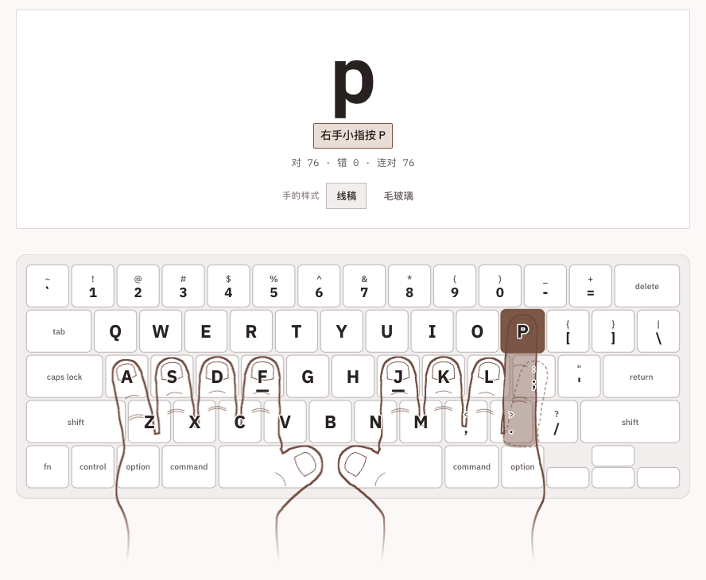
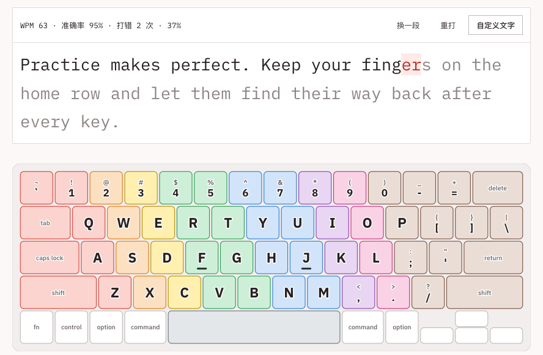
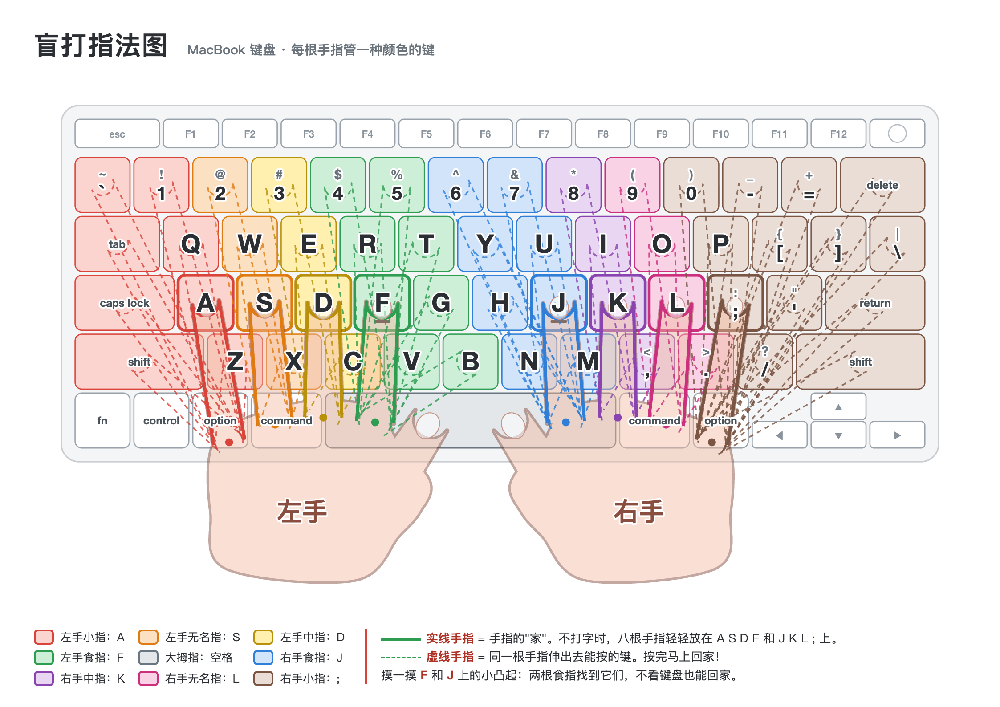

# touch-typing-trainer

浏览器里的盲打练习。先认清每个键归哪根手指，再在整段英文里练速度。

A browser-based touch typing trainer: learn which finger owns each key, then build speed on real text. Interface is in Chinese.

## 两种模式

### 熟悉键位



- 显示框随机出一个键，键盘上对应的键闪烁
- 键盘上搭着一双手，该用的那根手指用它的颜色淡淡填充
- 目标键不在基准键上时，这根手指反复「伸过去 → 收回来」，基准键上留一个虚线虚影，提醒按完要回家
- 手有两种样式：线稿 / 毛玻璃
- 只练单个键（48 个：小写字母、数字、符号、空格），不练 Shift 组合键

### 提升速度



- 显示框出现一段英文，盲打跟着敲
- 键盘不再有手，改为按手指上色：同一根手指负责的键颜色相同
- 打错标红后继续，可以按 delete 退格改正
- 实时显示 WPM 和准确率
- 支持自定义文字：粘贴任意英文，弯引号、破折号会自动换成键盘能打的字符，中文等打不出的字符会被去掉并提示

## 运行

不需要安装依赖，也不需要构建。代码用的是 ES 模块，浏览器不允许直接双击打开 `file://`，所以要起一个本地服务器：

```bash
git clone https://github.com/ijerrywong/touch-typing-trainer.git
cd touch-typing-trainer
python3 -m http.server 8765
```

然后打开 <http://localhost:8765/>。

练习前请切换到英文输入法，并关掉大写锁定（页面顶部会提示）。

## 开发

```bash
npm test          # 单元测试（Node 18+ 自带的 node:test，无需安装）
npm run lint:css  # 检查组件 CSS 里没有写死的颜色、尺寸
```

### 目录

```
index.html              主页面
src/
  app.js                拼装：两种模式、模式切换、输入分发
  keymap.js             键位数据：MacBook 美式键盘、每个键归哪根手指、字符 → 击键
  keyboard.js           虚拟键盘（SVG）
  hand-geometry.js      手的几何形状（纯函数）
  hand.js               手的渲染、手指伸向目标键的动画
  input.js              键盘输入：字符 / 退格 / 中文输入法 / 大写锁定
  drill.js              熟悉键位出题
  session.js            提升速度计分
  text.js               自定义文字清洗、示例文字
  textview.js           文字显示框
  styles/               样式（见下）
tests/                  单元测试
spikes/                 各模块的独立测试页，打开 /spikes/ 查看
vendor/ds/              设计 token 基础包（dashboard-swiss）
scripts/lint-css.mjs    CSS 字面量检查
make.py                 生成可打印的指法图 chart.html / chart.pdf
```

### 开发方式：先 spike，再拼装

每个模块先单独做成 spike 验证：纯逻辑写单元测试，界面做测试页截图核对；全部通过后再拼进主页面。各模块的验收标准、验证结果和已定的设计决定记在 [SPIKES.md](SPIKES.md)。

### 样式：全部 token 化

| 层 | 文件 | 能否写字面量 |
|---|---|---|
| 基础 token | `vendor/ds/dashboard-swiss/tokens.css` | 是（构建产物，不手改） |
| 应用 token：手指色、键盘尺寸、手的配色和动画节奏 | `src/styles/app-tokens.css` | **只有这里**可以 |
| 组件样式 | `src/styles/` 下其余文件 | 否，只能用 `var(--…)` |

想改外观（比如手指的颜色、手指伸缩的速度），只改 `app-tokens.css`。

## 指法图

`make.py` 生成一张 A4 横版的 MacBook 盲打指法图，可以打印出来贴在旁边：

```bash
python3 make.py   # 输出 chart.html，用 Chrome 打印成 PDF
```



## 协议

[MIT](LICENSE)
